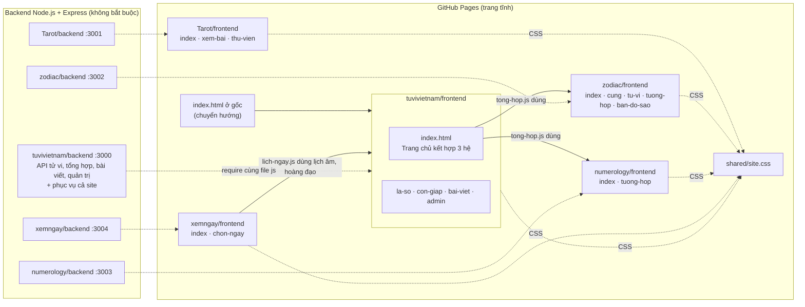

# Lá Số Tử Vi · kiến trúc

Website tâm linh tiếng Việt gồm 5 phần: **tử vi** phái Việt, **xem ngày tốt xấu**, **Tarot**, **cung hoàng đạo** và **số chủ đạo**. Trang chủ kết hợp tử vi, hoàng đạo và số chủ đạo để dự đoán may mắn, tình cảm, sự nghiệp.

- Web công khai: https://nakame9.github.io/Spiritual/ (GitHub Pages, phục vụ thẳng từ gốc kho)
- Toàn bộ tính toán chạy trên trình duyệt, nên trang tĩnh chạy được không cần máy chủ. Backend chỉ cần cho trang quản trị bài viết, hoặc khi muốn gọi API.

## Sơ đồ



## Thư mục

```
Spiritual/
├── README.md               Tài liệu này
├── package.json            Lệnh chung: cai-dat, test, menu, start
├── index.html, la-so.html, bai-viet.html   Chuyển hướng vào tuvivietnam/frontend (giữ link cũ)
├── shared/site.css         Màu, chữ, form, khung trang, sáng/tối. Một bản cho cả site
├── scripts/menu.js         Menu chính khai báo một chỗ, ghi vào mọi trang và kiểm tra lệch
├── tuvivietnam/            Tử vi + trang chủ          (frontend, backend, README)
├── xemngay/                Xem ngày tốt xấu           (frontend, backend, README)
├── Tarot/                  Tarot 78 lá                (frontend, backend, README)
├── zodiac/                 Cung hoàng đạo             (frontend, backend, README)
└── numerology/             Số chủ đạo (thần số học)   (frontend, backend, README)
```

Mỗi phần có cùng một khuôn:

```
<phần>/
├── frontend/          Trang HTML, css/<riêng>.css, js/ (lõi tính + giao diện từng trang)
├── backend/           server.js (API + phục vụ frontend), package.json, test/
└── README.md          Chức năng, cách tính, API của phần đó
```

## Mã dùng chung giữa trình duyệt và backend

Các file "lõi" viết theo kiểu UMD. Trên trình duyệt, file gắn một biến toàn cục. Trong Node, backend `require` chính file đó. Vì vậy web và API luôn ra cùng kết quả, và test của backend cũng kiểm tra luôn mã chạy trên web.

| Phần | File lõi (theo thứ tự nạp) | Biến toàn cục |
|---|---|---|
| Tử vi | `tuvi.js` (lịch âm Hồ Ngọc Đức, an sao) → `luangiai.js`, `congiap.js` | `TuVi`, `LuanGiai`, `ConGiap` |
| Trang chủ | `tong-hop.js` (cần lõi tử vi, hoàng đạo, số chủ đạo) | `TongHop` |
| Tarot | `y-nghia-chu-de.js` → `bo-bai.js` | `TarotChuDe`, `Tarot` |
| Hoàng đạo | `vendor/astronomy.browser.min.js` → `thien-van.js` → `cung-hoang-dao.js` → `luan-giai.js` | `Astronomy`, `ThienVan`, `HoangDao`, `ChiemTinh` |
| Số chủ đạo | `so-hoc.js` | `SoHoc` |
| Xem ngày | `lich-ngay.js` (cần `tuvi.js`, `congiap.js` của phần tử vi) | `XemNgay` |

File giao diện (`app.js`, `thu-vien.js`, `chung.js`, `trang-*.js`, `la-bai.js`, `ve-ban-do.js`) chỉ chạy trên trình duyệt.

Trang chủ nạp lõi của phần khác qua đường dẫn tương đối, ví dụ `../../zodiac/frontend/js/luan-giai.js`. Trong Node, `tong-hop.js` cũng `require` theo đường dẫn tương ứng.

## Backend và API

| Máy chủ | Cổng | API chính |
|---|---|---|
| `tuvivietnam/backend` | 3000 | `POST /api/la-so`, `POST /api/tong-hop`, `GET /api/con-giap`, `GET /api/bai-viet`, `/api/admin/*` (đăng nhập). Phục vụ thêm `/shared`, `/Tarot/frontend`, `/zodiac/frontend`, `/numerology/frontend`, `/xemngay/frontend` nên chạy một máy chủ này là đủ cả site |
| `Tarot/backend` | 3001 | `POST /api/rut-bai`, `GET /api/bo-bai?q=&nhom=`, `GET /api/la-bai/:id`, `GET /api/kieu-trai`, `GET /api/chu-de` |
| `zodiac/backend` | 3002 | `GET /api/xac-dinh`, `GET /api/tu-vi/:cung`, `GET /api/tuong-hop`, `POST /api/ban-do-sao`, `GET /api/cung`, `GET /api/dia-diem` |
| `numerology/backend` | 3003 | `GET /api/so-chu-dao`, `GET /api/tuong-hop`, `GET /api/y-nghia/:so`, `GET /api/chu-ky` |
| `xemngay/backend` | 3004 | `GET /api/ngay`, `GET /api/thang`, `GET /api/chon-ngay`, `GET /api/viec` |

Mọi máy chủ đều có `GET /api/health`. API công khai cho phép CORS. Dữ liệu sai trả mã 400 kèm lỗi tiếng Việt. Chi tiết từng API nằm trong README của từng phần.

## Lệnh thường dùng (ở gốc kho, Node.js 18+)

```bash
npm run cai-dat     # cài thư viện cho cả 5 backend
npm test            # kiểm tra menu + chạy test của cả 5 phần
npm start           # chạy cả site ở http://localhost:3000 (backend tử vi)
npm run menu        # sau khi sửa scripts/menu.js: ghi lại menu vào mọi trang
```

Mỗi phần vẫn chạy riêng được: `cd zodiac/backend && npm install && npm start`.

## Làm việc thường gặp

| Việc | Sửa ở đâu |
|---|---|
| Đổi màu, chữ, kiểu nút, menu cho cả site | `shared/site.css` |
| Thêm, bớt, đổi tên mục menu | `MENU` trong `scripts/menu.js`, rồi chạy `npm run menu` |
| Thêm trang mới trong một phần | Tạo `frontend/<trang>.html`, đặt `<nav aria-label="Menu chính"></nav>` và link `../../shared/site.css`, rồi chạy `npm run menu` |
| Thêm một phần mới | Tạo `<phần>/frontend` và `<phần>/backend` theo khuôn trên. Thêm lệnh vào `package.json` gốc, thêm mục vào `scripts/menu.js`. Nếu muốn `npm start` phục vụ luôn phần mới thì thêm tên thư mục vào vòng lặp phục vụ tĩnh trong `tuvivietnam/backend/server.js` |
| Sửa nội dung luận giải | Tử vi: trang quản trị (khi chạy backend) hoặc `tuvivietnam/frontend/js/luangiai.js`. Tarot: `bo-bai.js`, `y-nghia-chu-de.js`. Hoàng đạo: `cung-hoang-dao.js`, `luan-giai.js`. Số chủ đạo: `so-hoc.js`. Xem ngày: `xemngay/frontend/js/lich-ngay.js` (trực, sao, ngày kỵ, hướng, cách chấm điểm) |
| Đổi cách chấm điểm trang chủ | `tuvivietnam/frontend/js/tong-hop.js` (trọng số 40/60 cho tử vi, trung bình ba hệ) |

`npm test` sẽ báo lỗi nếu menu trên trang nào lệch khỏi `scripts/menu.js`, nên quên chạy `npm run menu` cũng bị phát hiện.
